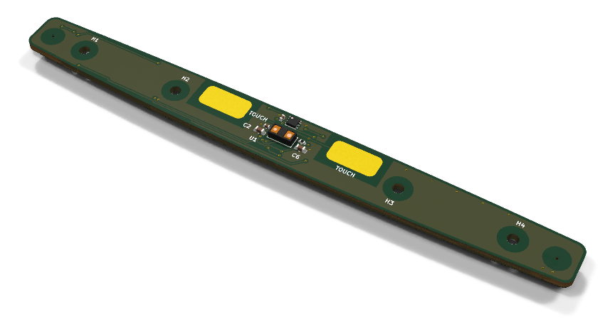
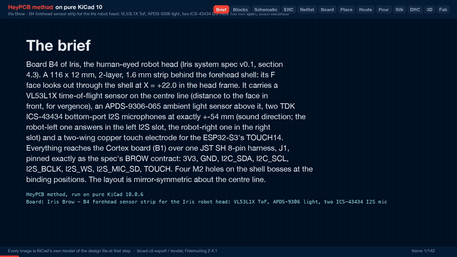
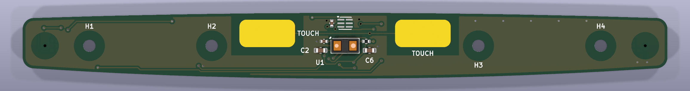
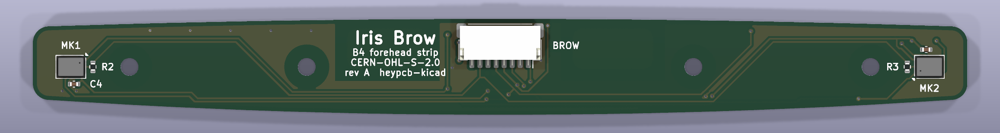
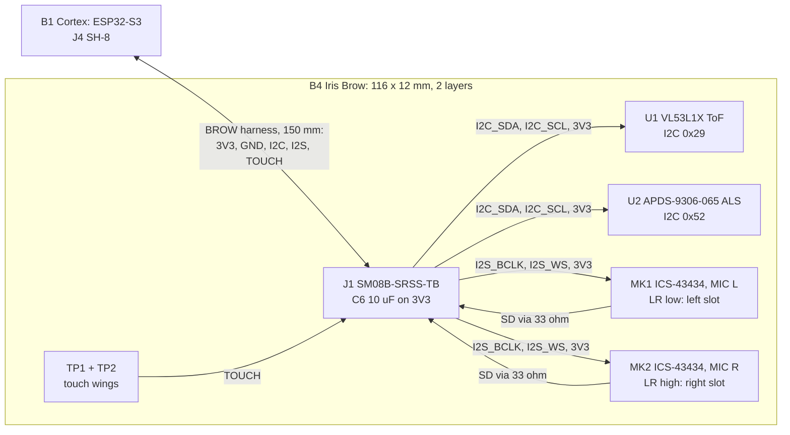
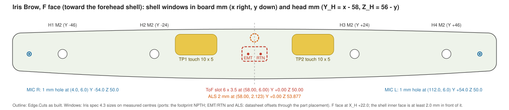
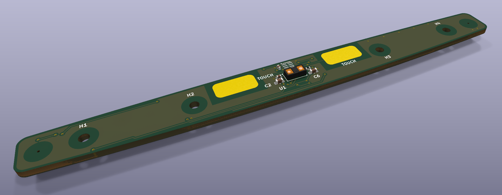

# Iris Brow

The forehead sensor strip of Iris: a VL53L1X distance sensor for vergence, an APDS-9306 light sensor, two I2S microphones 108 mm apart for sound direction and touch pads, on a brow-shaped board.

Part of [Iris, the human-eyed robot head](https://github.com/HeyPCB/iris), HeyPCB's open robot boards. Designed end to end with the HeyPCB method on
KiCad 10 (headless pipeline, Freerouting 2.4.1); every number below is measured on the files in this repository.
Mentions of `./run.sh`, `docs/rules/`, `blocks/` or `parts/` refer to the heypcb-kicad SDK that produced them.

<p align="center"></p>

| Layers | Outline | Parts | Nets | Connections routed | Vias | ERC errors | DRC errors / unconnected / parity |
|---|---|---|---|---|---|---|---|
| 2 | 116 x 12 mm, shaped | 20 | 11 | 45 -> 0 open | 33 | 0 | 0 / 0 / 0 |

**Not fabricated, assembled or powered.**

| | |
|---|---|
| KiCad project | [`kicad/`](kicad/) |
| Gerbers (unzipped and zipped), BOM, CPL, STEP, schematic PDF | [`fab/`](fab/) |
| Mechanism CAD, fit check and system docs | [Iris, the human-eyed robot head](https://github.com/HeyPCB/iris) |
| Renders | [top](media/top.png), [bottom](media/bottom.png) |
| Design process, every step as KiCad rendered it | [`media/design-process.mp4`](media/design-process.mp4) |

<p align="center"></p>

Iris Brow is the forehead sensor strip of **Iris**, an open-hardware robot head with human-like eyes. It
is board B4 of the Iris system spec v0.1 (section 4.3). The strip is 116 x 12 mm and sits behind the
forehead shell. It carries:
- a time-of-flight sensor for vergence distance;
- an ambient light sensor;
- two I2S microphones 108 mm apart, for the direction of a sound;
- a touch electrode.

One 8-pin JST SH harness connects it to the Cortex board (B1, ESP32-S3). It was designed with the HeyPCB
method on KiCad 10.0.6, by heypcb-kicad's headless pipeline with Freerouting 2.4.1, from the brief in
`board.json`.

**This board has not been fabricated, assembled or powered.** Everything below is what KiCad and the
pipeline measured on the design files. Nothing here has been tested on hardware or in the head. Gate
numbers come from `report.json`, positions and track lengths from
`coords.json` (written by `boards/iris_brow/coords.py`). Both come from the full run of
2026-10-03.





## Role in Iris

Iris has four board designs (spec section 4). B1 Cortex rides on the tilt cradle and runs the
ESP32-S3. B2 Brainstem is the power and servo hub. B3 is the iris LED ring, one in each eye. B4 Brow is
fixed to the forehead shell and adds what the eyes lack (spec section 4):

- **Distance for vergence.** The VL53L1X measures the distance d to the face in front of the robot.
  Firmware sets the vergence angle from it: vergence = 2 atan(39 / d) for the 78 mm IPD (spec section 8).
- **Ambient light.** It sets the brightness of the iris glow and the blink rate.
- **Stereo hearing for orienting saccades.** The two microphones are exactly 108 mm apart (head Y
  -54 and +54). That gives a maximum time difference of 0.31 ms, about 15 samples at 48 kHz (spec
  section 8, GCC-PHAT).
- **A forehead touch pad** for a "pat" reaction (ESP32-S3 TOUCH14).

## Features

- **ST VL53L1X** time-of-flight sensor (U1, VL53L1CXV0FY/1). It ranges up to 4 m with a field of view
  of up to 27 degrees, at up to 50 Hz (ST DocID031281 Rev 3, p.1 and Table 1). It sits on the centre
  line, on the face side.
  - ST's 100 nF and 4.7 uF are next to its AVDDVCSEL and AVSSVCSEL pins.
  - XSHUT is tied high through 10k, because it is not on the harness.
  - GPIO1 (the interrupt) is not connected, as the datasheet allows when it is unused.
- **Broadcom APDS-9306-065** ambient light sensor (U2), on the centre line above the ToF, with its
  datasheet 1 uF. Its INT output is not connected; firmware polls it.
- **Two TDK ICS-43434** bottom-port I2S microphones (MK1, MK2). They sit on the inside face and their
  0.5 mm sound ports open through the board at exactly x 4.0 and 112.0.
  - MK1 is MIC L (robot left). Its LR pin is low, so it answers in the **left** I2S slot.
  - MK2 is MIC R (robot right). Its LR pin is high, so it answers in the **right** slot.
  - Each has 100 nF at VDD and drives the shared SD line through 33 ohm.
- **Touch electrode:** two mirror-image 10 x 5 mm exposed copper pads (TP1 and TP2) on one TOUCH net,
  either side of the centre sensors. Espressif's keep-outs are board rule areas:
  - nothing on the opposite face;
  - a 1.5 mm gap to any ground or track;
  - a 0.15 mm trace.
- **J1:** JST SH 8-pin side-entry header SM08B-SRSS-TB, centred on the inside face with its mouth up.
  It is pinned exactly as the spec's BROW contract. A 10 uF bulk capacitor on 3V3 (C6) sits beside the
  ToF.
- **Board:**
  - a brow-shaped outline inside the binding 116 x 12 mm envelope, symmetric about the centre line;
  - 2 layers, 1.6 mm;
  - GND poured on both faces after routing;
  - four M2 holes at the binding positions.
- 20 footprints: 14 assembled parts, 2 copper touch pads (DNP), 4 holes. No regulator: 3V3 comes from
  the Cortex board.
- **3V3 load, from the datasheets** (a sum, not a measurement): about 19 mA on average, 41 mA at the
  ToF's emitter peaks. That is inside the contract's 50 mA. The parts are:
  - VL53L1X: 16-18 mA ranging average, peaks up to 40 mA (ST Table 16);
  - APDS-9306: 85 uA;
  - two ICS-43434: 490 uA each (TDK DS-000069, high-performance mode).

## Block diagram



## Sensor placement and windows

Board coordinates use the brief frame: mm from the board origin, x to the right and y down, seen from
the F face. Head coordinates use the spec's binding mapping (section 4.3):
- the F face is at X_H = +22.0 and faces the forehead shell;
- Y_H = x - 58;
- Z_H = 56 - y.

The shell's inner surface is at least 2.0 mm in front of the F face. Window sizes are the spec's
suggestions (section 4.3); the centres are measured from the built board.



| Feature | Board x, y (mm) | Head Y_H, Z_H (mm) | Face | Window in the shell (spec 4.3) | Where the centre comes from |
|---|---|---|---|---|---|
| VL53L1X package centre (U1) | 58.00, 6.00 | 0.00, 50.00 | F | one 6 x 3.5 mm slot centred here, or two 2.5 mm holes at the two points below | U1's placement |
| VL53L1X emitter (EMT, 0.70 mm aperture) | 56.48, 6.00 | -1.52, 50.00 | F | (inside the slot) | ST outline drawing through U1's placement |
| VL53L1X receiver (RTN, 0.85 mm lens) | 59.48, 6.00 | +1.48, 50.00 | F | (inside the slot) | ST outline drawing through U1's placement |
| APDS-9306 active area (U2) | 58.00, 2.12 | 0.00, 53.88 | F | 2 mm hole | Broadcom outline (0.223 mm off U2's centre at 58.00, 1.90) |
| MIC R sound port (MK2) | 4.00, 6.00 | -54.00, 50.00 | port through the board, part on B | 1.0 mm hole and a foam gasket ring | the footprint's 0.5 mm NPTH, measured |
| MIC L sound port (MK1) | 112.00, 6.00 | +54.00, 50.00 | port through the board, part on B | 1.0 mm hole and a foam gasket ring | the footprint's 0.5 mm NPTH, measured |
| Touch TP1 (robot right) | x 39.0-49.0, y 1.25-6.25 | Y -19.0 to -9.0, Z 54.75 to 49.75 | F, exposed copper | none (see *Check before ordering*) | pad copper, measured |
| Touch TP2 (robot left) | x 67.0-77.0, y 1.25-6.25 | Y +9.0 to +19.0, Z 54.75 to 49.75 | F, exposed copper | none | pad copper, measured |

**How the windows are marked on the board.** The SDK has no brief key for free drawings on the silk or
Fab layers, and its code was not changed. So each window is marked in four ways:
- **A named rule area on F.Cu that also bans the pour.** The F face therefore shows a bare-laminate
  patch of the window's shape round each sensor:
  - `window_tof_slot_6x3.5` (x 55.0-61.0, y 4.25-7.75; no via, no pour);
  - `window_als_d2` (2.4 mm circle at 58.00, 2.12; no via, no pour);
  - `window_mic_r_port_seal` and `window_mic_l_port_seal` (5 mm circles at the ports; no track, via
    or pour, so a gasket seals on flat mask).
- **The parts' own F.Fab outlines and values**, where the footprint has them.
- **The microphones' NPTH ports**, which go through the board.
- **The silk words "TOUCH"** beside the two pads.

"TOF" and "ALS" are in the brief's silk words, but found no free spot. A 0.8 mm word's text box is
1.47 mm tall, and the gap between the two sensors is 1.3 mm; capacitors and vias hold their other
sides. The drawing above and `coords.json` carry every number.

**Mounting and outline (binding positions kept).**
- Four 2.2 mm NPTH holes for M2 screws, at (12, 6), (34, 6), (82, 6) and (104, 6). In the head frame
  that is Y_H -46, -24, +24, +46 at Z_H +50.0. The screws go in from the B side into bosses on the shell,
  whose tips touch the F face.
- Copper, tracks and vias stay out of a 5.6 mm circle round each hole on both faces.
- The outline stays inside the spec's 116.0 x 12.0 mm envelope and is symmetric about x = 58.
  - Top edge: y = 1.0 ((x - 58) / 58)^2.
  - Bottom edge: y = 12 - 2.0 ((x - 58) / 58)^2.
  - Both are sampled every 14.5 mm and filleted (1000 mm and 600 mm on the shallow vertices, 2 mm at
    the four ends). So the strip is 12.0 mm tall at the centre and 9.0 mm at the ends.
  - The measured Edge.Cuts box is x -0.05 to 116.05 and y -0.04 to 12.03 (it includes the 0.1 mm
    line).
- **J1** is centred on the B face at (58.00, 3.35), with its mouth at y 0.73 (Z_H 55.27), so the plug
  enters from above (+Z). Pin 1 is at x 54.5 (Y_H -3.5) and pin 8 at x 61.5 (Y_H +3.5).

**Heights.** These come from the datasheets and the catalogue; none of them is a measurement.
- F face: VL53L1X 1.56 mm (the tallest; spec limit 1.6 mm), APDS-9306-065 0.65 mm, 0402 and 0603
  passives.
- B face: the SM08B-SRSS-TB body (the JLC row lists 2.9 mm and 4.32 mm), ICS-43434 0.98 mm (spec limit
  4.5 mm). `fab/iris_brow.step` has the board with KiCad's 3D bodies. U2 has no body:
  KiCad 10.0.6 ships no model for `OptoDevice:Broadcom_DFN-6_2x2mm_P0.65mm`.

## Pinout: J1 to Cortex J4 (spec section 5, BROW, binding)

JST SH 8-pin, SM08B-SRSS-TB (C160407). Pin n is pad n of the KiCad footprint. The harness is
double-ended, same direction (pin n to pin n), 28 AWG, 150 mm. The board nets below were read back from
the run's `build/iris_brow/design.json`.

| Pin | Net | Dir | Level / type | On this board |
|---|---|---|---|---|
| 1 | 3V3 | B1 -> B4 | 3.3 V, at most 50 mA (source B1 U2) | U1 AVDD/AVDDVCSEL, U2 VDD, MK1/MK2 VDD, MK2 LR, XSHUT pull-up, C6 10 uF |
| 2 | GND | | | ground; J1's two mounting pads are GND too |
| 3 | I2C_SDA | <-> | 3.3 V open drain, 400 kHz | U1 pin 9, U2 pin 2. No pull-up here: 2.2 k on B1 only |
| 4 | I2C_SCL | B1 -> | 3.3 V open drain | U1 pin 10, U2 pin 1 |
| 5 | I2S_BCLK | B1 -> B4 | 3.3 V, 3.072 MHz | MK1 and MK2 SCK |
| 6 | I2S_WS | B1 -> B4 | 3.3 V, 48 kHz | MK1 and MK2 WS |
| 7 | I2S_MIC_SD | B4 -> B1 | 3.3 V, tri-stated per slot | MK1 and MK2 SD, each through 33 ohm. The 100 k pull-down is on B1 (GPIO40) |
| 8 | TOUCH | B4 -> B1 | analog, capacitive | TP1 and TP2 (B1 GPIO14, TOUCH14) |

## I2C addresses and I2S slots

| Device | Board | 7-bit address | Note |
|---|---|---|---|
| INA226 | B2 | 0x40 | spec section 4.3 |
| VL53L1X (U1) | B4 | **0x29** | ST writes it as **0x52**, the 8-bit write address (datasheet section 4, Figure 12). Use 0x29 in a 7-bit API, or it lands on the APDS-9306 |
| APDS-9306-065 (U2) | B4 | **0x52** | fixed ("single slave address of 0X52 hex using 7-bit addressing", Broadcom AV02-4755EN) |

No two addresses collide. The camera's SCCB is on its own pins on B1.

| Microphone | Position | LR | I2S slot |
|---|---|---|---|
| MK1, MIC L | robot left, Y_H +54.0 | GND | left: data after WS falls |
| MK2, MIC R | robot right, Y_H -54.0 | 3V3 | right: data after WS rises |

Each frame has 64 SCK cycles (TDK DS-000069), so BCLK is 48 kHz x 64 = 3.072 MHz.

## Departures from the spec

| Spec (section 4.3) | On the board | Why |
|---|---|---|
| Rectangle, 116.0 x 12.0 mm, fillet 2.0 | A brow-shaped outline inside the same envelope (12 mm tall at the centre, 9 mm at the ends), with the same holes | The task asked for a gently shaped brow strip. Anything drawn for the rectangle still clears it |
| Touch electrode at x 40-52, masked F copper, with a ground-hatched ring | Two 10 x 5 mm exposed pads at x 39-49 and 67-77; no pour within 1.5 mm, nothing on B under them, solid GND pour beyond | Symmetry: a pat anywhere across the middle of the forehead lands on it. The shell is at least 2.0 mm in front of the board, and Espressif says to remove air gaps or bridge them with springs, which needs an exposed pad. KiCad's stock wire and test pads all open the mask. The SDK pours solid copper only, so there is no hatched ring |
| APDS-9306 at x 65-67 | At x 58 (centre line), y 1.9, above the ToF | A symmetric layout about the centre line |
| J1 at x 86-98 on B | Centred on B (x 52-64), mouth up | A symmetric B face, equal I2S runs to both microphones, and the shortest harness path |
| Microphone SD pins tied directly (datasheet stereo figure) | 33 ohm source resistor on each | KiCad types SD as an output, so ERC refuses two on one net. The resistor also damps the shared line |
| ICS-43434 orientation not stated | Ports outboard, pads inboard | The pads face the rest of the board. Routing closed only once each microphone's bypass capacitor had its GND pad beside the port's GND ring (MIC R's LR pin is 3V3, so its ring has no other GND neighbour) |
| (not in the spec) | 10 uF on 3V3 | Bulk at the end of the 150 mm cable for the ToF's emitter pulses (40 mA peak, ST Table 16) |

## Measured gates (full run with media, 2026-10-03, from `report.json`)

| Gate | Result |
|---|---|
| Composition | 7 block instances (6 distinct blocks, all new, prefixed `brow_`): 20 parts, 11 nets, 4 no-connects (U1 GPIO1, U1 DNC, U2 INT, U2 NC) |
| Part binding (`parts/lcsc_pinned.json`) | 14 of 14 orderable parts bound, 0 unsourced, 0 identity conflicts. H1-H4 are not in the BOM; TP1 and TP2 are DNP (copper only). 4 distinct Extended parts (C160407, C190004, C2649498, C5656610), about $12 in JLC loading fees |
| ERC (`kicad-cli sch erc --severity-all`) | **0 errors, 0 warnings** |
| Netlist round trip | **identical**, 11 nets |
| Freerouting, rung 1, fanout off (kept) | 45 -> 4 open (all GND). The last-mile router closed all 4, and DRC kept them: **0 open** |
| Freerouting, rung 1, fanout on (for comparison) | 45 -> 8 open; the last mile closed 5, so 3 open |
| Copper | 204 tracks, 28 routing vias, 732.5 mm of track (B.Cu 467.8 mm, F.Cu 264.7 mm). No net class was narrowed |
| Pours (only after a measured 0 open) | GND on F.Cu and B.Cu, 5 stitching vias (33 vias in all). 0 open after the pour, after stitching and at the end |
| Silkscreen | 3 words placed (TOUCH, TOUCH, BROW); the 4 title lines on B; 12 designators re-seated and 5 hidden; 0 stitching vias displaced |
| DRC (`--severity-all --schematic-parity`, KiCad 10.0.6) | fresh, **0 errors, 0 warnings, 0 unconnected, 0 parity** |
| DFM (`jlcpcb_2layer`) | **0 errors**, 1 warning: 45 stock-footprint silk strokes at 0.12 mm, which the fab prints at its 0.15 mm minimum |
| Fab gate | **ready**, no blockers. Two copper gerbers; the gerber job has `LayerNumber` 2 and a 1.6 mm board. The BOM has 10 rows and 14 parts; the JLC CPL lists 14 parts (7 on the bottom) and corrected 4 rotations |
| Media | 63 3D frames, the renders, and a 97.7 s video (142 frames) |

Routing depends on the last mile. Freerouting alone left four GND connections open, all at the
microphones: MK1's port ring, LR pin and bypass capacitor, MK2's port ring, and a 47.7 mm link from C4
back to the centre. The brief routes the same way every run (`docs/rules/pipeline.md`, "One brief routes
one way"). All three routing runs after the last placement change (two `--no-media` runs and the full
run) routed 45 -> 0.

Routed lengths (`coords.json`):

| Net | Length (B.Cu + F.Cu) | Vias |
|---|---|---|
| TOUCH | 30.0 mm (2.0 + 28.0) | 1 |
| I2S_BCLK | 121.3 mm (98.9 + 22.4) | 4 |
| I2S_WS | 124.6 mm (68.7 + 55.9) | 4 |
| I2S_MIC_SD | 113.2 mm (113.2 + 0) and 1.6 mm from each microphone to its 33 ohm | 0 |
| I2C_SDA / I2C_SCL | 12.0 / 21.9 mm | 2 / 2 |
| 3V3 | 159.4 mm | 8 |

## Check these before ordering

The board passes ERC, the netlist round trip, routing, DRC (errors, unconnected and parity), DFM and the
fab gate in KiCad. It has not been fabricated, assembled, powered or fitted to a head.

**Microphones**
- **The ICS-43434 is end of life.** TDK's product page marks it "EOL"
  (https://invensense.tdk.com/products/ics-43434/), and it names no replacement.
  - JLC stock on 2026-10-03 was **3 807** (C5656610, live lookup). Buy both microphones, plus spares,
    with the first order.
  - **The alternative is the spec's: Infineon IM69D120V01**, C3171853, 282 in stock on 2026-10-03.
    It is a PDM microphone, so it is not a drop-in:
    - a different package, footprint and pinout;
    - I2S0 on the ESP32-S3 must run in PDM receive mode;
    - this board needs a respin with a new `brow_mic_*` block.
- **SD line load.** TDK designed the SD output to drive 85 pF (DS-000069, "SD output drive strength").
  The load is:
  - 113.2 mm of SD copper on this board;
  - the other microphone's tri-stated pin (about 6 pF, same section);
  - the 150 mm harness;
  - B1's trace and the ESP32-S3 input.

  Check the edges with a scope on the first board.
- **The servos are loud:** 65 +- 5 dB at 30 cm each (spec section 2.7), so the spec gates sound
  localisation during servo moves (section 8).
- **The ports need the shell's 1.0 mm holes**, aligned to x 4.0 and 112.0, with a gasket. The 5 mm
  circles round the ports are flat mask for it.

**VL53L1X cover and crosstalk**
- **ST's ranging figures assume no cover glass** (DocID031281 Rev 3, section 3.1, test conditions).
  Whatever covers the sensor, the shell must keep ST's exclusion cones clear. Those cones are "kept free
  of mechanical items" (outline drawing, page 2, note 4):
  - receiver: 39.60 degrees full angle, 1.08 mm across at the module's top face;
  - emitter: 36.50 degrees, 0.84 mm across.
- **Derived from those cones** (not measured): at a height h above the module's top, the receiver
  cone is 1.08 + 0.720 h mm across and the emitter cone 0.84 + 0.660 h mm.
  - The module top is 1.56 mm above the F face, and the shell's inner face 2.0 mm above it, so h = 0.44
    mm at the shell's inner face: 1.40 mm (receiver) and 1.13 mm (emitter).
  - The spec's **6 x 3.5 mm slot** (straight walls, centred at x 58.00) clears both cones through a shell
    up to **2.28 mm** thick.
  - The spec's alternative, **two 2.5 mm holes** at the emitter and receiver, clips the receiver's cone
    in a shell thicker than **1.53 mm**, and leaves a 0.5 mm web between the holes.
- **An open slot avoids cover crosstalk.** An IR-transparent cover reflects part of the emitter's
  pulse straight into the receiver. If the shell needs a cover:
  - add a light barrier between the emitter and receiver windows;
  - calibrate crosstalk and offset in firmware;
  - measure it on the printed forehead (spec, open question 6).
- **I/O level.** The driver runs the pads in 1V8 mode by default; on this 3.3 V bus firmware must set
  2V8 mode (ST Table 14, notes 3-4; spec section 4.3, register 0x2E bit 0).

**Touch electrode**
- **The air gap.** The shell is at least 2.0 mm in front of the pads. Espressif: "any air gaps between
  the sensor pad and overlay must be eliminated", or "compressed metal springs can be used". Plan one of
  these:
  - a touch spring or conductive foam on each pad (the pads are bare for this);
  - a copper-tape electrode on the shell's inside, wired to a pad.
- **Size.** Each pad is 10 x 5 mm with rounded corners, about the area of a 7.9 mm circle. That is just
  under Espressif's 8-15 mm electrode range; the two pads together are about an 11 mm circle. They are
  one electrode: a palm covers both.
- **Ground and spacing differ from Espressif's guidance** (ESP32-S3 hardware design guidelines; the
  esp-iot-solution touch design note).
  - Done as advised: no copper under the pads on B, ground pour at least 1.5 mm away on F, a 0.15 mm
    trace, and 30.0 mm of TOUCH copper on this board (the limit is 300 mm, including the harness and
    B1).
  - Not as advised:
    - the pour beyond the gap is solid, not hatched;
    - the trace-to-ground gap is 0.35 mm, not 0.5-1 mm, because J1's pads 7 and 8 are 0.40 mm apart.
  - Measured on the board: on the same layer, the TOUCH copper is at least 2.83 mm from I2S_BCLK and
    2.33 mm from I2C_SCL.
  - The TOUCH track crosses the board's middle on F between the ALS and the ToF (y 3.75), so a touch
    near the centre of the forehead also counts. Check the readings while the ToF ranges: the track
    passes about 1.1 mm from the ToF's emitter supply pins.
- **B1 needs the series resistor.** Espressif recommends 470 ohm to 2 kohm (510 ohm) within 1 mm of the
  touch pin. That belongs on the Cortex board at GPIO14; the spec's GPIO table does not list it.

**Assembly and mechanics**
- **Two-sided assembly.**
  - Top: U1, U2, C1-C3, C6, R1.
  - Bottom: J1, MK1, MK2, C4, C5, R2, R3.
  - The JLC CPL marks the bottom parts as Bottom. TP1 and TP2 are DNP: bare copper, nothing placed.
- **No 3D body for U2.** KiCad 10.0.6 ships no model for its footprint, so the renders and the STEP
  show bare pads there. Use the datasheet's 2.0 x 2.0 x 0.65 mm.
- **J1's mouth is 0.73 mm inside the top edge, and the cable leaves upward (+Z) at the head's centre
  line.** Route the 150 mm BROW cable over the upper-lid servo column. The spec put J1 at Y_H +28 to
  +40; check the cable path in CAD.
- **Stackup.** The gerber job lists KiCad's default 2-layer stackup (35 um copper, 1.51 mm FR4,
  1.6 mm). The fab's real stackup is chosen when ordering.

**Sourcing**
- The 10 part numbers in `fab/iris_brow_bom.csv` all come from
  `parts/lcsc_pinned.json`. This board added five rows on 2026-10-03 from live `heypcb parts lookup`
  reads:
  - C190004 VL53L1CXV0FY/1, 12 199 in stock;
  - C2649498 APDS-9306-065, 5 253;
  - C160407 SM08B-SRSS-TB(LF)(SN), 267 231;
  - C19666 4.7 uF 0603, Basic;
  - C25105 33 ohm 0402, Basic.

  The ICS-43434 row (C5656610) was pinned earlier, on 2026-10-02. Stock and Basic/Extended class go
  stale; re-check on jlcpcb.com before ordering.

## Files

In this folder (committed):
- `board.json`: the brief.
- `coords.py`: measures the mechanical numbers above from the built board and draws the window map.
- `img/`:
  - `iris_brow_face_side.png`, `iris_brow_inner_side.png` and `iris_brow_angled.png`: KiCad 10 raytraced
    renders;
  - `iris_brow_windows.svg`: the window map, a copy of `windows.svg`.

The blocks are `blocks/brow_*.json`; the part rows are in `parts/lcsc_pinned.json`.

Under `build/iris_brow/` (regenerated, not committed):
- `report.json`: the gate report.
- `coords.json` and `windows.svg`.
- `iris_brow.kicad_sch` and `iris_brow.kicad_pcb`.
- `fab/`:
  - `iris_brow_gerbers.zip`;
  - `iris_brow_bom.csv`;
  - `iris_brow_cpl_jlc.csv`;
  - `iris_brow_pos.csv`;
  - `iris_brow_schematic.pdf`;
  - `iris_brow.step`.
- `media/design-process.mp4`.



## Reproduce

From the heypcb-kicad repository:

```bash
./run.sh --board boards/iris_brow              # every stage, with the renders and the video (about 7 min)
./run.sh --board boards/iris_brow --no-media   # stop before the 3D frames, renders and video (about 2 min)
"${KICAD_APP:-/Applications/KiCad/KiCad.app}/Contents/Frameworks/Python.framework/Versions/Current/bin/python3" \
    boards/iris_brow/coords.py   # KiCad's Python, as run.sh picks it: positions, windows, track lengths
```

Clear `build/iris_brow/frames` and `build/iris_brow/render` before a full run, or the video replays
earlier runs (`docs/rules/pipeline.md`).

## Licence and sources

The Iris Brow hardware design (the brief, the `brow_*` blocks, `coords.py`, the renders and this README)
is licensed under the **CERN Open Hardware Licence Version 2, Strongly Reciprocal (CERN-OHL-S-2.0)**,
https://ohwr.org/cern_ohl_s_v2.txt, as the Iris spec states for all Iris hardware. KiCad's symbols,
footprints and 3D models are CC-BY-SA-4.0 with the KiCad library exception. No datasheet is copied
here; each fact above cites its source:

- ST VL53L1X datasheet, DocID031281 Rev 3. Pins (Table 2), the application schematic and its notes
  (Figure 3), address 0x52 (section 4, Figure 12), I/O modes (Table 14), current (Table 16), and the
  outline and exclusion cones (Figures 18-19): https://www.st.com/resource/en/datasheet/vl53l1x.pdf
- Broadcom APDS-9306/APDS-9306-065 datasheet, AV02-4755EN. Pins (p.2), supply and current (p.3), 7-bit
  address 0x52, the application circuit with 1 uF (p.15), and the outline with its active-area offset
  (p.18): https://docs.broadcom.com/docs/AV02-4755EN
- TDK InvenSense ICS-43434 datasheet, DS-000069. Pins and LR, 0.1 uF, the SD pull-down (Table 8), 64 SCK
  per frame, and the 85 pF SD drive:
  https://www.cdiweb.com/datasheets/invensense/ds-000069-ics-43434-v1.0-2.pdf. EOL status: https://invensense.tdk.com/products/ics-43434/
- Espressif, ESP32-S3 hardware design guidelines, Touch Sensor (electrode 8-15 mm, trace at most 0.18 mm
  and 300 mm, 0.5-1 mm to ground, hatched ground):
  https://docs.espressif.com/projects/esp-hardware-design-guidelines/en/latest/esp32s3/pcb-layout-design.html
- Espressif, touch sensor design note (esp-iot-solution release/v1.0): ground plane (section 3.3.7), air
  gaps and springs (section 3.1.1), and the series resistor:
  https://github.com/espressif/esp-iot-solution/blob/release/v1.0/documents/touch_pad_solution/touch_sensor_design_en.md
- The Iris system spec v0.1 (not published): sections 2.6, 4.3, 4.5, 5, 6, 8 and 10. Its binding
  contracts are in [the Iris system docs](https://github.com/HeyPCB/iris/blob/main/docs/system.md).
